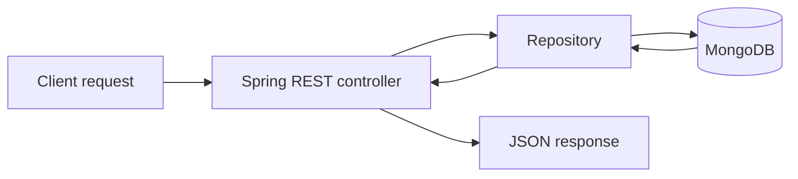

# EcomServer

A Spring Boot REST API for e-commerce users, products, and orders.

## Overview

EcomServer provides REST controllers backed by MongoDB repositories and models. OpenAPI documentation is available through Springdoc Swagger UI.

## Key Features

- User, product, and order API controllers
- MongoDB persistence models and repositories
- Order status and user role enums
- Shared resource-not-found exception handling
- Swagger UI and OpenAPI endpoint documentation

## Tech Stack

Java 21, Spring Boot 3.5, Spring Web, Spring Data MongoDB, Springdoc OpenAPI, and Maven.

## Workflow



## Project Structure

```text
.
├── pom.xml
├── Dockerfile
└── src/main/java/com/mtd/ecom_server/
    ├── controllers/
    ├── models/
    ├── repos/
    ├── enums/
    └── exceptions/
```

## Installation and Execution

Requires Java 21 and a reachable MongoDB instance. Configure the MongoDB connection using the Spring application configuration for your environment, then run:

```bash
./mvnw spring-boot:run
```

On Windows:

```powershell
.\mvnw.cmd spring-boot:run
```

The local Swagger UI is available at [http://localhost:8080/swagger-ui/index.html](http://localhost:8080/swagger-ui/index.html). A deployed Swagger UI is linked in the repository as [EcomServer API](https://ecom-server-coxu.onrender.com/swagger-ui/index.html).

## Author

**Gireesh Sadanand Patgar** · [GitHub](https://github.com/gireeshpatgar17)
